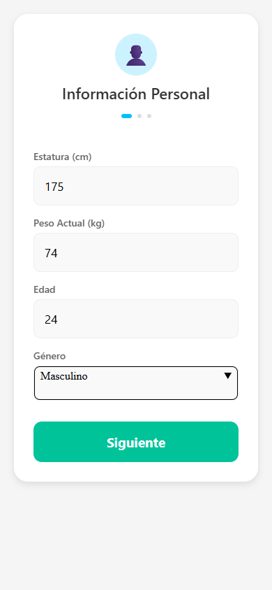
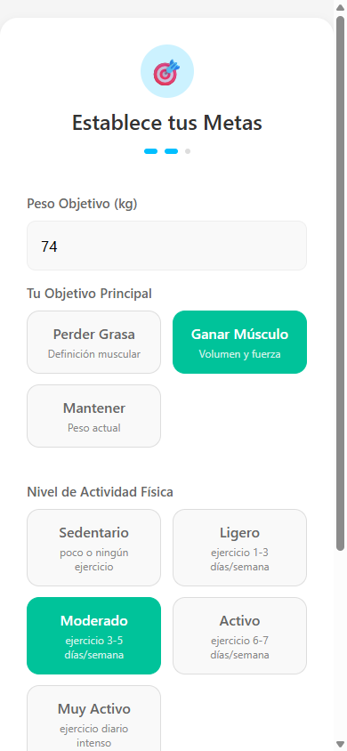
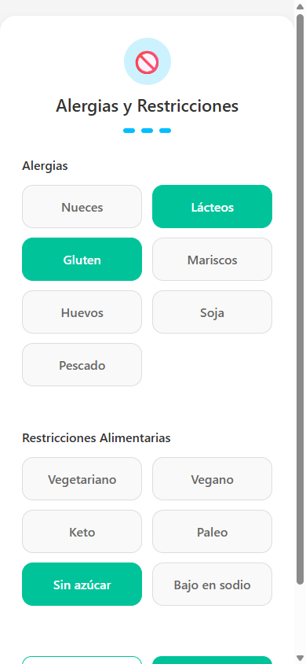
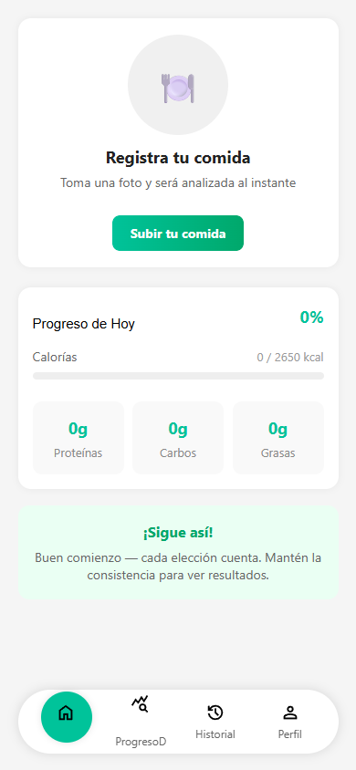
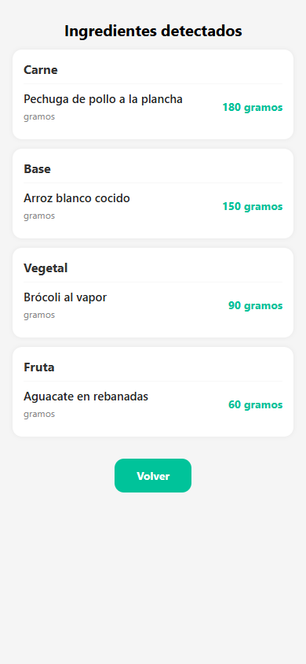

# NutriAI — Asistente de Nutrición con Visión Multimodal 

Aplicación móvil multiplataforma (**iOS, Android y Web**) desarrollada con **React Native, Expo Router, TypeScript y Google Gemini** que calcula metas calóricas personalizadas mediante la ecuación de **Mifflin-St Jeor** y analiza fotografías de platillos para detectar ingredientes visibles y estimar porciones en formato **JSON estructurado**.

---

## Problema y Solución

Registrar manualmente cada ingrediente y gramaje de las comidas diarias suele generar fricción y abandono en apps de nutrición. **NutriAI** simplifica este flujo combinando cálculo metabólico personalizado con análisis visual asistido por IA:

1. **Onboarding nutricional en 3 pasos:** Captura de datos biométricos, cálculo automático de Tasa Metabólica Basal (**TMB**) y meta calórica diaria según nivel de actividad y objetivo físico, además de alergias y restricciones alimentarias.
2. **Análisis visual literal de alimentos:** El usuario selecciona o toma una foto de su comida; la app la codifica en Base64 y la envía a **Gemini 2.5 Flash** con un prompt de ingeniería estricto (`api/promt.js`) que evita alucinaciones de recetas y devuelve únicamente componentes visibles en JSON estructurado.
3. **Clasificación automática por categoría:** Los resultados se agrupan en categorías (`carne`, `base`, `vegetal`, `fruta`, `salsa`, `queso`, `condimento_visible`, `otro`) con cantidad y unidad estimadas.

---

## Funcionalidades Principales

### Onboarding Biométrico y Cálculo Calórico
- **Información personal (`app/index.tsx`):** Estatura (cm), peso actual (kg), edad y género con validaciones y selector nativo (`ActionSheetIOS` en iOS / `Picker` en Android y Web).
- **Objetivos y metabolismo (`app/objetivos.tsx`):**
  - Cálculo automático de **TMB** usando la ecuación de **Mifflin-St Jeor**.
  - Factores de actividad física (`1.2` Sedentario hasta `1.9` Muy Activo).
  - Ajuste calórico automático según meta (**Perder Grasa**, **Ganar Músculo** o **Mantener**) y peso objetivo, garantizando un mínimo saludable (`>= 1200 kcal`).
- **Alergias y restricciones (`app/restricciones.tsx`):** Selección mediante chips interactivos de alergias (nueces, lácteos, gluten, mariscos, huevos, soja, pescado) y estilos alimentarios (vegetariano, vegano, keto, paleo, sin azúcar, bajo en sodio).

### Escaneo Multimodal con Gemini 2.5 Flash
- Selección de imágenes desde galería/dispositivo con `expo-image-picker` y conversión a Base64 mediante `expo-file-system`.
- Prompt especializado en [`api/promt.js`](./api/promt.js) diseñado para salida JSON estricta (sin Markdown ni deducción de ingredientes ocultos).
- Vista de resultados ([`app/view.tsx`](./app/view.tsx)) que parsea la respuesta de Gemini y presenta los ingredientes agrupados por categoría con sus cantidades y unidades.

### Dashboard Diario
- Tarjeta principal para subir/escanear platillos con estado de carga e indicadores visuales.
- Resumen diario de calorías consumidas frente a la meta calórica calculada, barra de progreso porcentual, tarjetas de macronutrientes y barra de navegación flotante (`FloatingNav`).

---

## Capturas de Pantalla

<table>
  <tr>
    <td align="center" width="20%">
      <br />
      <sub><b>1. Datos biométricos</b></sub>
    </td>
    <td align="center" width="20%">
      <br />
      <sub><b>2. TMB y meta calórica</b></sub>
    </td>
    <td align="center" width="20%">
      <br />
      <sub><b>3. Alergias y dieta</b></sub>
    </td>
    <td align="center" width="20%">
      <br />
      <sub><b>4. Dashboard y escaneo</b></sub>
    </td>
    <td align="center" width="20%">
      <br />
      <sub><b>5. Resultado IA (JSON)</b></sub>
    </td>
  </tr>
</table>

---

## Stack Tecnológico

| Capa | Tecnologías |
| :--- | :--- |
| **Framework & UI** | React Native `0.81`, React `19`, Expo SDK `54`, Expo Router `6`, TypeScript |
| **IA Multimodal** | Google Generative AI SDK (`@google/generative-ai`) — Modelo `gemini-2.5-flash` |
| **Medios y UI Nativa** | `expo-image-picker`, `expo-file-system`, `expo-linear-gradient`, `@react-native-picker/picker` |

---

## Estructura del Proyecto

```text
NutriAI/
├── api/
│   └── promt.js                # Prompt de ingeniería para análisis visual literal en JSON
├── app/
│   ├── index.tsx               # Paso 1: Formulario de datos personales
│   ├── objetivos.tsx           # Paso 2: Cálculo de TMB (Mifflin-St Jeor) y calorías meta
│   ├── restricciones.tsx       # Paso 3: Selección de alergias y restricciones alimentarias
│   ├── home.tsx                # Dashboard diario e integración con Gemini 2.5 Flash
│   ├── view.tsx                # Desglose categorizado de ingredientes detectados
│   ├── historial.tsx           # Vista de historial de comidas
│   └── progreso.tsx            # Vista de seguimiento de progreso
├── components/
│   └── FloatingNav.tsx         # Navegación inferior flotante
├── docs/screenshots/           # Capturas de pantalla de la aplicación
└── .env.example                # Plantilla de variables de entorno
```

---

## Instalación y Ejecución Local

### Prerrequisitos
- **Node.js** 18+ y **npm**
- Clave de API de **Google Gemini** (puedes obtenerla en [Google AI Studio](https://aistudio.google.com/apikey))
- **Expo Go** (para dispositivo físico) o navegador web

### 1. Clonar e instalar dependencias

```bash
git clone https://github.com/EduardoVazquez1881/NutriAI.git
cd NutriAI
npm install
```

### 2. Configurar variables de entorno

Copia [`.env.example`](./.env.example) como `.env` en la raíz del proyecto y coloca tu clave de Gemini:

```bash
cp .env.example .env
```

```env
EXPO_PUBLIC_GEMINI_API_KEY=tu_api_key_de_gemini_aqui
```

### 3. Iniciar la aplicación

```bash
# Menú interactivo de Expo
npm start

# Ejecutar en Web, Android o iOS
npm run web
npm run android
npm run ios
```

---

## Autor

**Eduardo Vázquez** — Desarrollador de Software | Backend & Full Stack  
- Portafolio: [eduardovazquez.online](https://eduardovazquez.online)
- GitHub: [@EduardoVazquez1881](https://github.com/EduardoVazquez1881)
